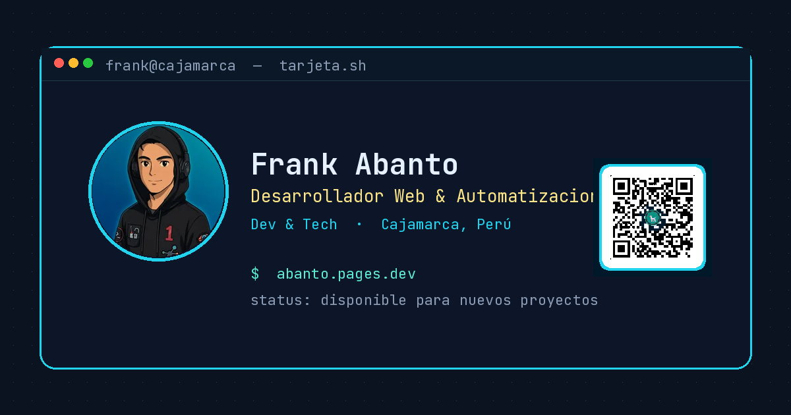

<div align="center">

<a href="https://frankusqabant.github.io/">
  
</a>

# Tarjeta digital · Frank Abanto

**Una tarjeta de presentación con aire de terminal: enlaces, código QR, contacto y compartir, en una sola página.**

[](https://frankusqabant.github.io/)


[](LICENSE)

### [Abrir la tarjeta →](https://frankusqabant.github.io/)

</div>

---

## ✨ Qué incluye

| | |
|---|---|
| 🔗 **Enlaces a redes** | Portafolio, WhatsApp, Instagram, GitHub, LinkedIn, YouTube y X, en botones grandes pensados para el pulgar. |
| 📱 **Código QR** | Se abre desde la cabecera, y en pantallas anchas queda a un lado, para que te escaneen desde otro equipo. |
| 👤 **Guardar contacto** | Genera una vCard (`.vcf`) y la descarga, sin servidor. |
| 📤 **Compartir y copiar** | Usa el menú de compartir del móvil o copia el enlace al portapapeles. |
| 🦙 **Mascota llama** | Una llama dibujada en SVG en la cabecera: un guiño andino que casi no pesa. |
| ♿ **Accesible** | Teclado con foco visible, textos alternativos, objetivos táctiles de 44 px y sin transiciones si pides movimiento reducido. |

## 🧱 Estructura

```
index.html          la tarjeta: HTML, CSS y JS en un solo archivo
assets/            avatar, QR, favicon, imagen para compartir y la fuente
scripts/huella.mjs mantiene al día la huella de seguridad del script
```

## 🛠️ Editar y publicar

Los datos de la tarjeta están en el objeto `CONFIG` de `index.html`:

```js
const CONFIG = {
  name: "Tu nombre",
  title: "Tu titular",
  location: "Tu ciudad, País",
  portfolio: "https://tu-portafolio.com",
  whatsapp: "51XXXXXXXXX",
  github: "https://github.com/tu-usuario",
  // … instagram, linkedin, youtube, facebook, x
};
```

Como la política de seguridad solo deja correr el script con una huella concreta, **después de editar el script ejecuta**:

```bash
node scripts/huella.mjs
```

Y para publicar, `git push` a `main`: GitHub Pages lo despliega solo.

## 🔒 Privacidad y seguridad

- **Sin terceros:** ni fuentes externas, ni analíticas, ni peticiones a otros sitios.
- **Sin rastros:** no guarda nada en el navegador.
- **Política de contenido** dentro del HTML: solo se ejecuta el script de la propia tarjeta.
- **Escaneo de secretos** activado en el repositorio.

## 📄 Licencia

[MIT](LICENSE) · © 2026 Frank Abanto
